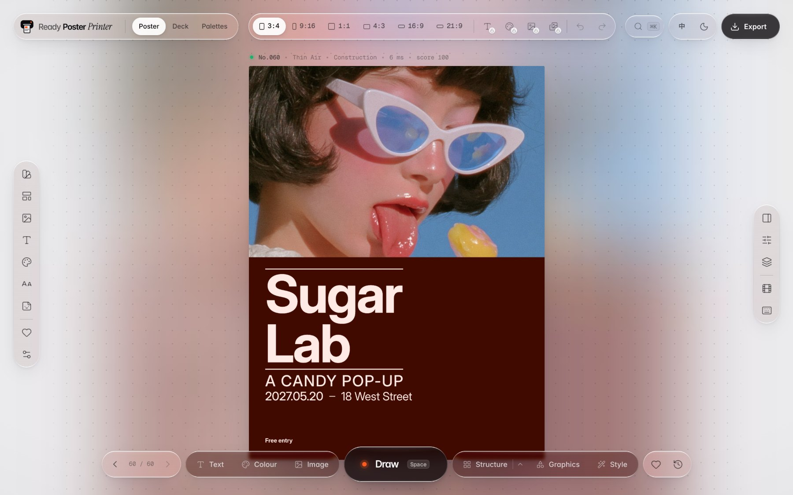
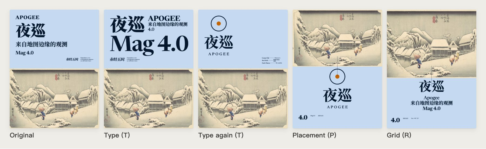
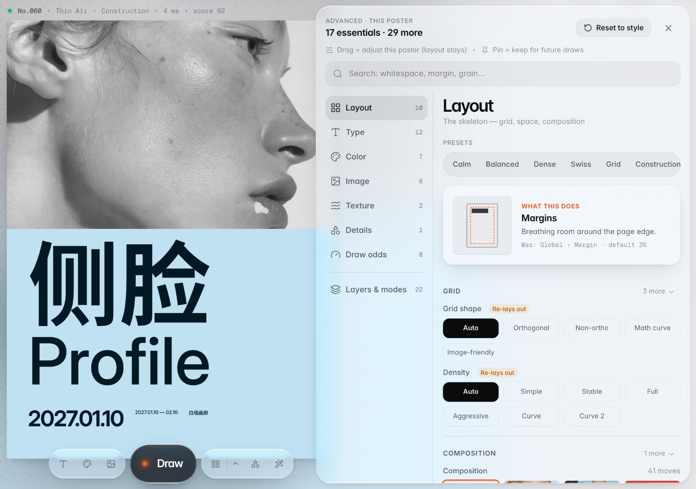
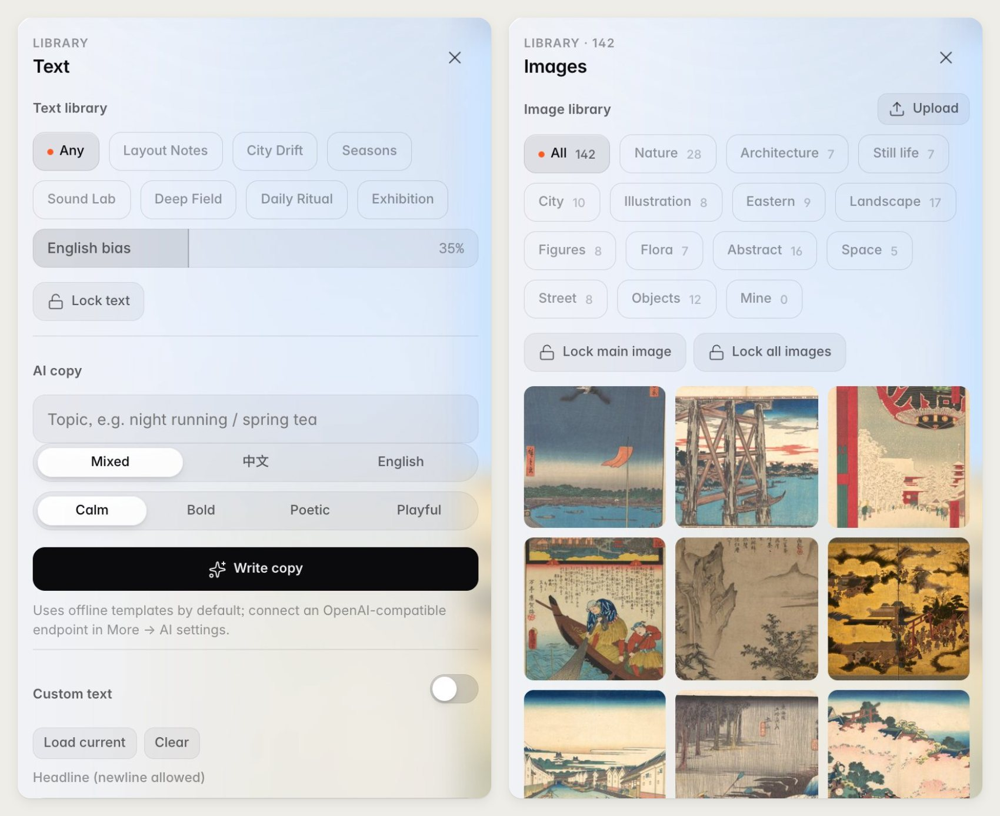
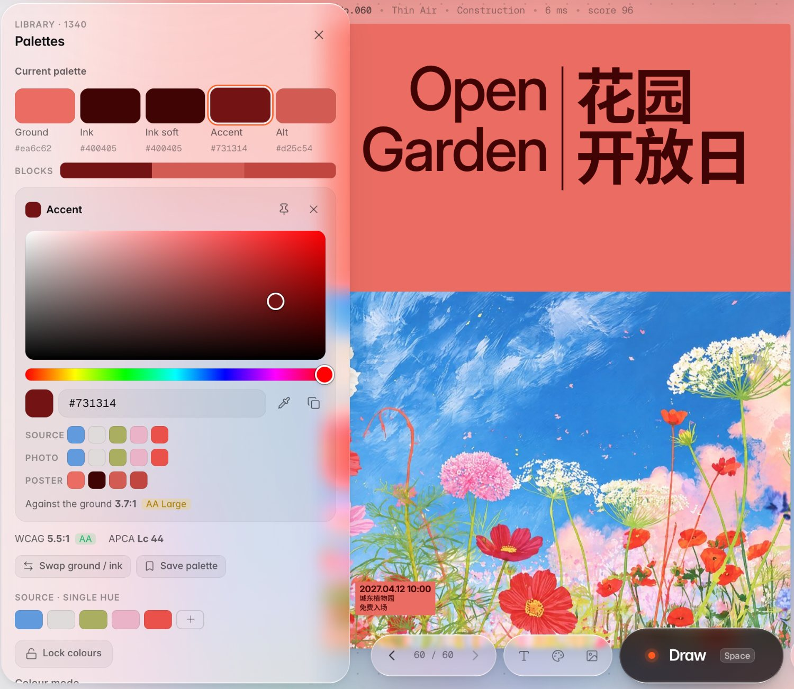
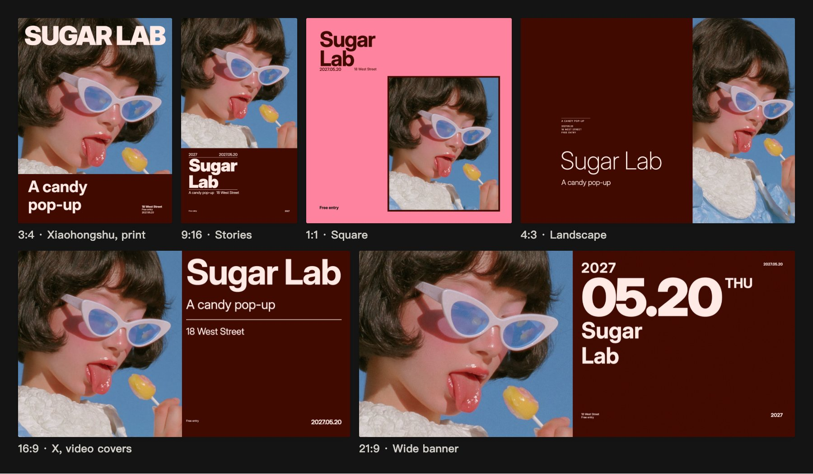
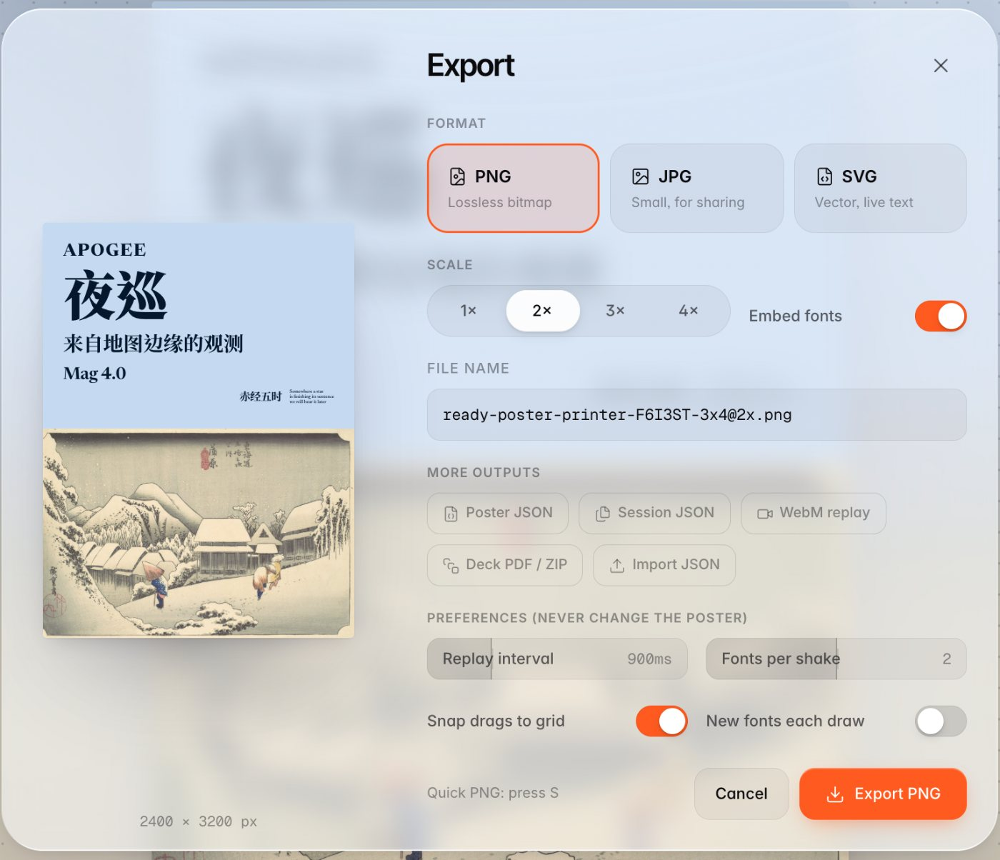
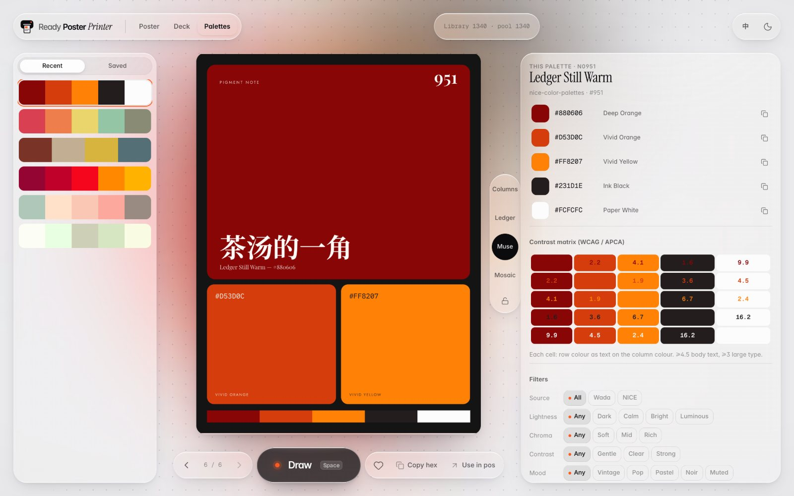
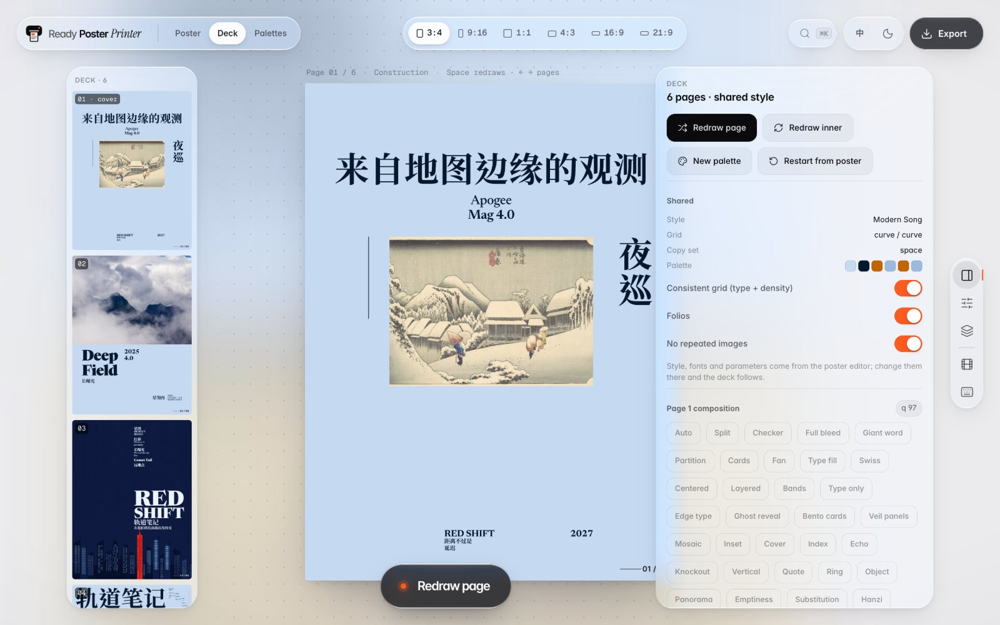

<div align="center">

# Ready Poster Printer

**One random pull, and you've got a designer-level poster.**

[简体中文](README.md) · English

**[Download and double-click to run (macOS / Windows)](#the-easy-way-download-and-double-click)**

</div>


You have the title, the date and the venue, but you can't make them look good together. Hand them over, press **Draw**, and you get a finished poster. Don't like it? Draw again. When one clicks, fine-tune it.

Speed is a side effect. What it really cares about is getting each poster right: the layout sits on a real grid, the type has a clear hierarchy, and every poster is checked so the text stays readable on its background. The words are real text, not painted pixels, so there are no misspellings or garbled letters, and you can click any line to edit it.


## Why it exists

- **You can write the content but not lay it out.** Title, date, venue, lineup: it's all there, and it still doesn't look right.
- **Templates look like templates.** People can tell, and it reads as cheap. Hiring a designer is slow and expensive, and for a small event it isn't worth it.
- **AI image generators get the text wrong.** The lettering comes out misspelled or messy, so the image ends up as a background and you set the type yourself anyway.
- **One piece of content needs several sizes.** Portrait, square, banner: each one means doing the layout again.

## What using it is like

### Draw until you see the one



No blank canvas. Press Space or **Draw**. It lays out 8 candidates, scores them, and shows you the best. Keep drawing until something clicks; ← / → takes you back through what you've seen.

There are 41 layout methods. The newest one, the construction engine, sets the type in one of 34 text constructions on one of 19 page archetypes. Its rules come from a graphic design course and a long study of real covers and posters. No two draws look quite alike, which makes it hard to stop. You can export a run of draws as a WebM video, and "look what I pulled" makes a post on its own.

### Change only the part you don't like



The picture is in exactly the right place and only the type is off? Open the small arrow next to **Structure** and change one layer:

- **Type (T)** re-sets only the text: line breaks, alignment, headline size and where the details sit. The pictures don't move.
- **Placement (P)** moves and resizes the pictures, and the type is set again around them.
- **Grid (R)** switches to another grid (columns, margins, rows) and keeps the same layout idea.

The **Text, Colour, Image, Graphics and Style** buttons along the bottom each swap one thing and leave the rest alone.

### Lock in what you like, and every poster after it matches



Click any text on the poster to edit it, drag it, or change its font and color. The Advanced panel has dozens of settings grouped by layout, type, color, image, texture and details, with a search box. Most of them change only the poster in front of you without breaking its layout.

Every setting has a pin. Pin it, and every poster you draw from then on keeps that value. The top bar can also lock the text, the colors, the main image or all images. Once you've found a look you like, lock it, and everything you make afterwards stays consistent. That's handy for an account you post to every day.

### Your words, your photos



In the **Text** panel, turn on **Custom text** and fill in the headline, subtitle, date and venue, and the poster uses your words. If you don't have copy yet, it can write some: offline templates produce Chinese and English copy out of the box, or you can connect any OpenAI-compatible endpoint.

Upload photos in the **Images** panel; they stay in your own browser. Set the palette source to **From image** and the colors come from your photos, so the poster matches your event photos or brand colors instead of somebody else's template.



Every colour in the palette panel is yours to set: ground, text, accent, block fills. Click one to drag a new colour, type a hex code, or sample one straight from a photo with the eyedropper. The poster follows live and the layout basically stays put. Got a colour combination in your head? Add it as source colours and the poster is coloured from them. Save palettes you like under **My palettes** for one-click reuse, and pin a colour to keep it on every poster you draw after.

> For now, the web app sometimes leaves out a minor line of your copy, and a few layouts fill in a couple of sample words. Check the poster before you post it. When every detail has to be right, as for a formal event, use the [command-line version](#for-ai-agents-and-scripts-the-command-line-version) below, which checks every item.

### One piece of content, every size



Keys 1–6 switch between six aspect ratios: 3:4 for Xiaohongshu and print, 9:16 for Stories, 16:9 for X and video covers, plus 1:1, 4:3 and 21:9. The text, colors and pictures stay the same; only the layout is redone.

### Export



- **PNG / JPG** at 1–4×. Press S for a quick PNG.
- **SVG** with live, editable text and optional embedded fonts. Open it in Illustrator or Figma and keep going. Designers can use it as a layout-ideas machine.
- **Multi-page PDF or a ZIP of PNGs**, made in **Deck** for booklets or poster series.
- **Poster JSON**, so you can load it again later and keep editing.

### And also

| Palettes | Deck |
|---|---|
|  |  |
| Draw from 1,340 palettes, with a WCAG / APCA contrast matrix, and send one to your poster in a click. | Pages share a style, grid and palette, and each page is drawn on its own. Good for booklets and poster series. |

There's also a 200-entry history with favorites, a ⌘K command palette, dark mode, a Chinese and English interface, and optional local AI cut-outs (so a person can stand in front of the headline).

## How it differs from AI image generators

| | AI image generators | Ready Poster Printer |
|---|---|---|
| Text | Painted into the image; may be misspelled and can't be edited | Real text you can click and edit |
| Layout | Different every time and hard to control | Follows a grid, a type hierarchy and spacing rules |
| Legibility | Up to luck | Text contrast is checked on every poster and fixed when it's too low |
| Other sizes | Generate again | Six aspect ratios, one key each |
| Output | Bitmap | PNG, JPG, editable SVG, PDF |

It doesn't make the pictures. Use your own photos, AI-generated images, or the 142 openly licensed images it ships with. An image generator for the picture plus this for the type is a good pairing.

## For AI agents and scripts: the command-line version


The same layout engine runs from the command line, for batch output or for an AI agent like Claude to call. Give it real copy and pictures, and it generates a ranked set of candidates. Each one comes with a report that checks:

- that the title, date, venue and other details appear on the poster exactly as given;
- that the text has enough contrast and is large enough for where the poster will be seen;
- that Chinese line breaks follow the rules and no characters are missing;
- that every picture is used and its subject isn't cropped away.

Candidates that fail are dropped, and the output says why. If too few pass, it fills the set with candidates whose problems are clearly flagged (`--strict` returns only the ones that pass).

```bash
ready-poster-printer generate --title "教室里的春天" --subtitle "Picture Books for Spring" \
  --date 2027-03-14 --venue "城市少儿图书馆" --image picturebooks.jpg -n 8 -o out/
```

Results export as PNG, SVG or PDF, or as JSON that the web app can open for hand-tuning. To use it from an AI agent, load the skill in [ready-poster-printer](poster-printer-cli/skills/ready-poster-printer/SKILL.md). It explains how to choose a layout from the pictures and copy.

## Run it on your own computer

Everything runs locally. No account needed.

### The easy way: download and double-click

No command line needed. Three steps:

1. **Download** the package [ready-poster-printer-dist.zip](https://github.com/ALBEDO-TABAI/ready-poster-printer/releases/latest/download/ready-poster-printer-dist.zip) (about 96 MB; it's also on the [Releases](https://github.com/ALBEDO-TABAI/ready-poster-printer/releases/latest) page).
2. **Unzip** it. You get a `ready-poster-printer` folder.
3. **Double-click** the launcher inside:
   - **macOS**: `start.command`
   - **Windows**: `start.bat`

After a few seconds the poster editor opens in your browser (at http://localhost:5180/). When you're done, close the black terminal window to quit.

You need **Python 3.9 or newer**. No Node.js required.

- **Mac**: most Macs already have it. If double-clicking asks you to install the "command line developer tools", click Install, then double-click again.
- **Windows**: download it from [python.org](https://www.python.org/downloads/), and on the first screen of the installer tick **Add python.exe to PATH**.

The first time, your system may stop the launcher because it was downloaded from the internet. Nothing is wrong:

- **Mac** says it can't be opened: go to System Settings → Privacy & Security, scroll down to the message and click **Open Anyway**. Or right-click `start.command` → Open → Open.
- **Windows** shows "Windows protected your PC": click **More info** → **Run anyway**.

Your posters, favorites and uploaded images stay in your own browser.

### Web app (for developers)

You need Node.js 22.12 or newer. Fonts, preset images and palette data are already in the repository.

```bash
git clone https://github.com/ALBEDO-TABAI/ready-poster-printer.git
cd ready-poster-printer/poster-printer
npm ci
npm run dev
```

Open the local address printed in the terminal. Full instructions: [web app README](poster-printer/README.md).

To build a package like the one above yourself, run `npm run dist`. It's written to `poster-printer/release/ready-poster-printer-dist.zip`.

### Command line

Run `npm ci` for the web app first, then from the repository root:

```bash
cd poster-printer-cli/engine
npm ci
npm run build
cd ../agent-harness
python3 -m venv .venv
.venv/bin/python -m pip install -e .
.venv/bin/ready-poster-printer --help
```

You need Python 3.10+ and one of Chrome, Chromium, Edge or Brave. It finds them automatically, or you can set `POSTER_PRINTER_CHROME`. On Windows, use `.venv\Scripts\ready-poster-printer.exe`. The old command name `poster-printer` still works. Details: [CLI README](poster-printer-cli/agent-harness/cli_anything/poster_printer/README.md).

## Keyboard shortcuts

| Key | What it does |
|---|---|
| Space | Draw a poster |
| ← / → | Step through history |
| 1–6 | Switch aspect ratio |
| T / P / R | Change only the type / placement / grid |
| ⇧1–4 | Lock text / colors / main image / all images |
| S | Quick PNG export |
| ⌘K | Command palette |
| ? | All shortcuts |

## License

Original program code is licensed under **GNU AGPL v3.0 only (AGPL-3.0-only)**; the full terms are in [LICENSE](LICENSE).
Fonts, images, palette data and third-party code keep their own licenses and credits; see [third-party licenses](poster-printer/licenses/).
