<div align="center">

# Ready Poster Printer

**随手一抽，就是一张设计师水准的海报。**

简体中文 · [English](README.en.md)

**[下载运行包，双击就能用（macOS / Windows）](#最简单下载后双击打开)**

</div>

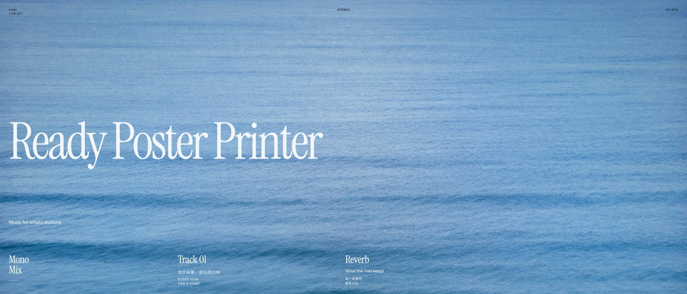

标题、日期、地点都有了，就是排不好看？把内容交给它，按一下「抽一张」，一张排好版的海报就出来了。不喜欢就再抽，抽到喜欢的再慢慢调。

快只是顺带的，它真正在意的是每一张都排得对：版面落在真正的网格上，字号有清楚的层级，每张都会检查文字在背景上看不看得清。海报上的字是真正的文字，不是画出来的，所以不会有错字和乱码，点一下就能改。

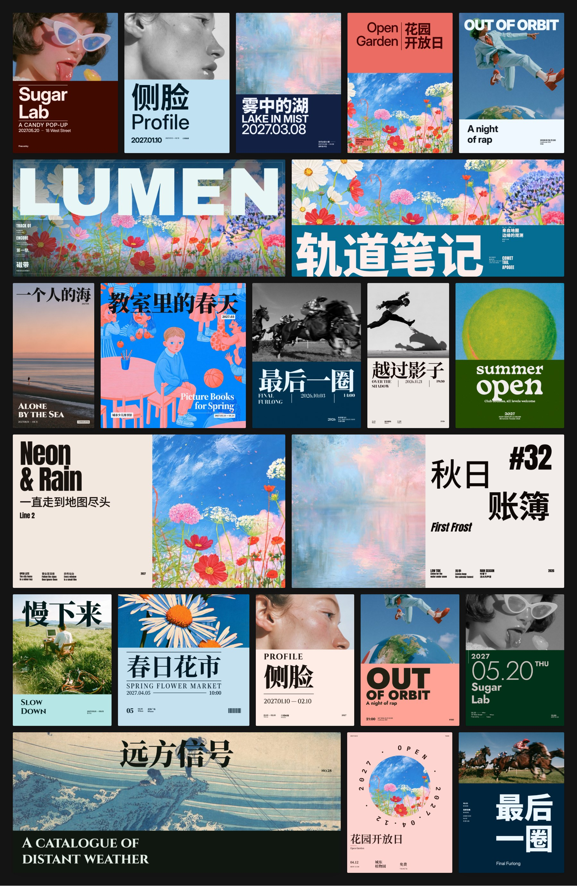

## 为什么做它

- **内容会写，版排不好。** 标题、日期、地点、嘉宾都齐了，放在一起总觉得哪里不对。
- **模板容易撞款。** 别人一眼就看得出是哪个模板，还显得廉价。请设计师吧，小活动又太慢、太贵，不值得。
- **AI 生图的字靠不住。** 字常常写错、排乱，最后只能拿来当背景，字还得自己排。
- **一份内容要好几个尺寸。** 竖版、方图、横幅，每个都得重新排一遍。

## 用起来是什么样

### 抽卡：说不清想要什么，看到就知道

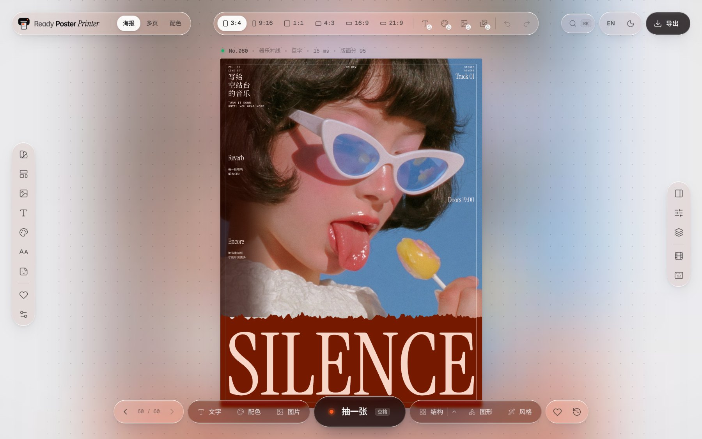

不用对着空白画布发呆。按空格或「抽一张」，它会先排出 8 个候选，自动打分，把最好的一张给你。不满意就接着抽，按 ← / → 可以翻回前面的。

版式有 41 种构图手法。其中「构成编排」把文字的排法又细分成 34 种文字组构成和 19 种页面原型，规则来自一套平面设计课程，以及大量封面和海报作品的拆解。每次抽到的都不太一样，抽着抽着就停不下来。整个抽卡过程还能导出成 WebM 视频，「看我抽到了什么」本身就是一条内容。

### 只换不满意的那部分

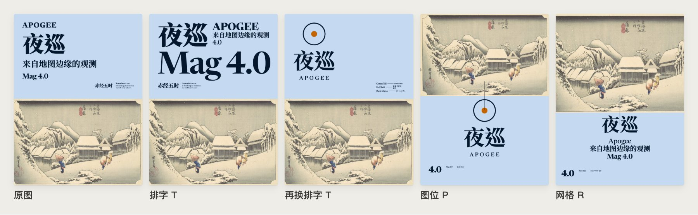

图片的位置刚刚好，只是字排得不对？点「结构」旁边的小箭头，可以只换其中一层：

- **排字（T）**：只换文字的排法，断行、对齐、字号和信息块的位置都会变，图片一动不动。
- **图位（P）**：换图片的位置和大小，文字围着新位置重新排。
- **网格（R）**：换一套网格（栏数、页边距、行），版式思路不变。

满版图、环形字这类版式里，图片的位置本身就是设计，图位换不了，按下去会提示原因。

底部的「文字、配色、图片、图形、风格」也都能单独换，其余部分保持原样。

### 喜欢了就锁住，以后每张都是这个调性

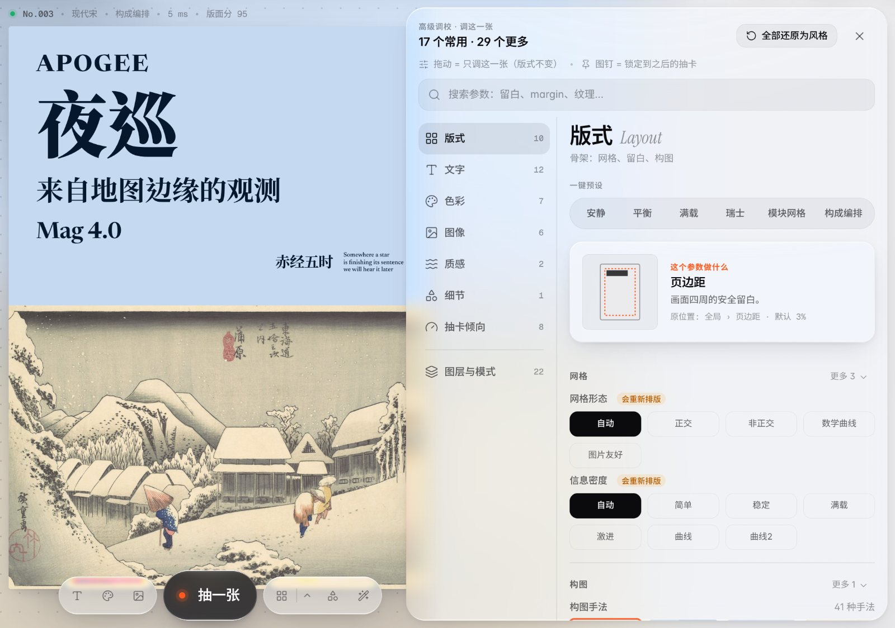

海报上的字可以直接点开修改，也可以拖动、换字体和颜色。高级面板里的几十个参数按版式、文字、色彩、图像、质感、细节分好了组，也能直接搜索。大部分参数只改眼前这一张，版式不会乱。

每个参数旁边都有一个图钉，钉住之后，以后抽的每一张都沿用这个值。顶栏还能锁定文字、配色、主图或全部图片。抽到满意的风格就锁好，之后做的每一张都是同一个调性，很适合需要天天更新的账号。

### 用你自己的字和照片

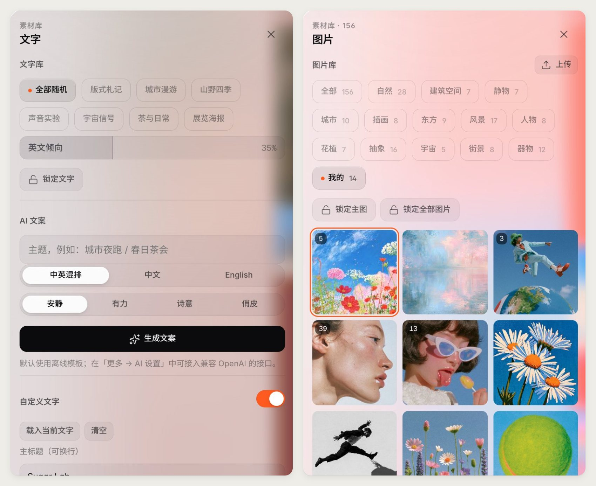

在「文字」面板里打开「自定义文字」，填上主标题、副标题、日期地点这些信息，海报就会用你的文字。还没想好文案也可以让它来写：默认用离线模板生成中英文案，也可以接一个兼容 OpenAI 的接口。

在「图片」面板上传照片，照片只存在你自己的浏览器里。把配色来源设成「图片提取」，海报的颜色就从你的照片里取，和活动照片、品牌色自然搭在一起，不会像套了别人的模板。

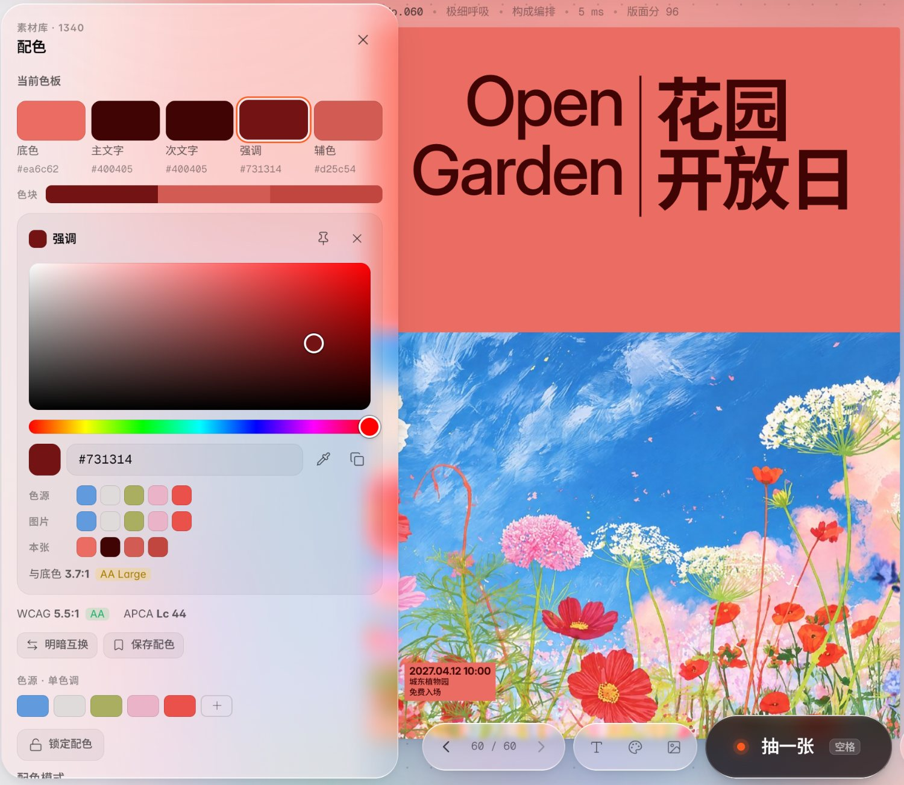

配色面板里的每一个颜色都能自己定：底色、文字、强调色、色块，点开就能拖动取色、输入色号，或者用吸管直接吸照片上的颜色。海报实时跟着变，版式基本不动。灵光一闪想到的配色组合，加进「色源」就能用；喜欢的配色存进「我的配色」，下次一键套用。想让以后每张都用同一个颜色，点它旁边的图钉就行。

> 目前网页版用你自己的文字时还不够稳：测试里将近一半的海报会省掉一行次要信息（多半是副标题），或者在较早的版式里补上几个示例词。最稳的是「构成编排」：在「版式」面板的版式库里点它锁定，就不会再补示例词，只是有时还会省掉副标题。发出去前请看一眼。正式活动这类每条信息都必须准确的场合，建议用下面的[命令行版](#给-ai-助手和脚本用命令行版)，它会逐条核对。

### 一份内容，所有尺寸

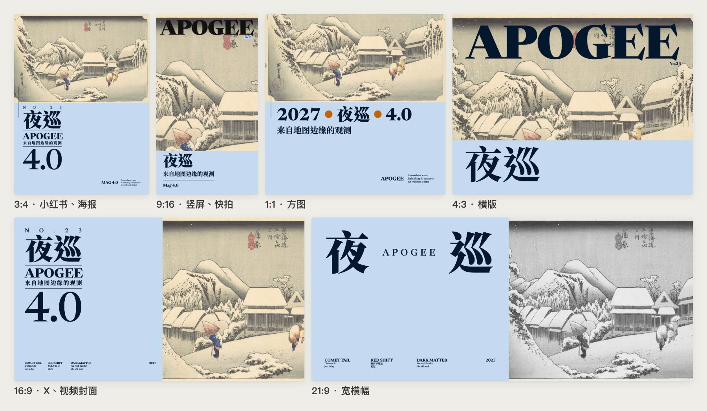

按 1–6 切换六种画幅：3:4 适合小红书和印刷海报，9:16 适合竖屏和快拍，16:9 适合 X 和视频封面，另外还有 1:1、4:3 和 21:9。切换画幅时文字、配色和图片都不变，只是重新排版。

### 导出

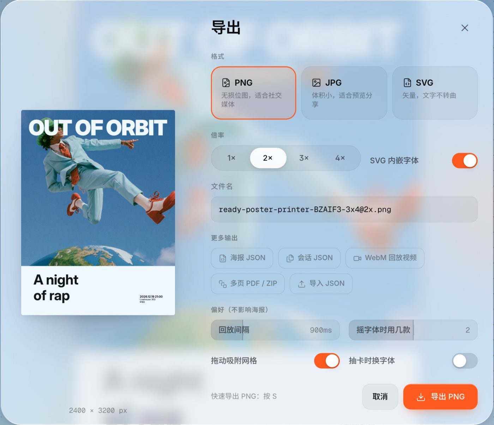

- **PNG / JPG**：1–4 倍，按 S 直接导出 PNG。
- **SVG**：文字不转曲，还能选择内嵌字体。拿到 Illustrator 或 Figma 里可以接着改，设计师也可以把它当成排版灵感机。
- **多页 PDF / PNG 压缩包**：在「多页」里做小册子或系列海报。
- **海报 JSON**：存下来，以后导回来接着改。

### 还有这些

| 配色页 | 多页文档 |
|---|---|
| 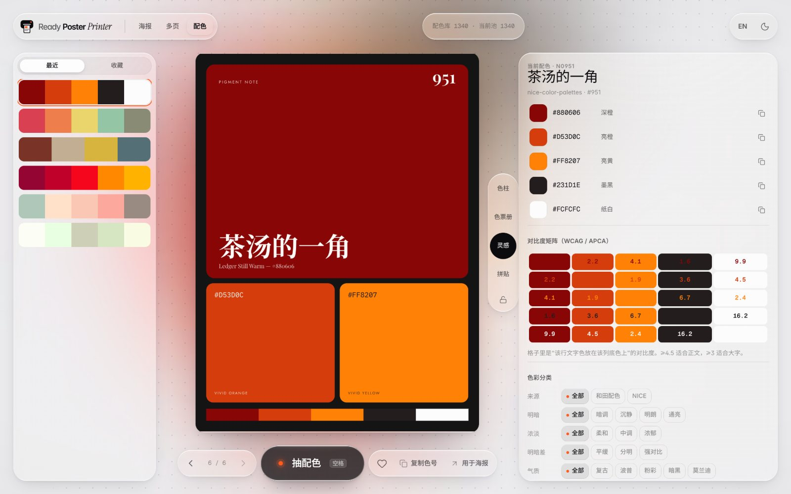 | 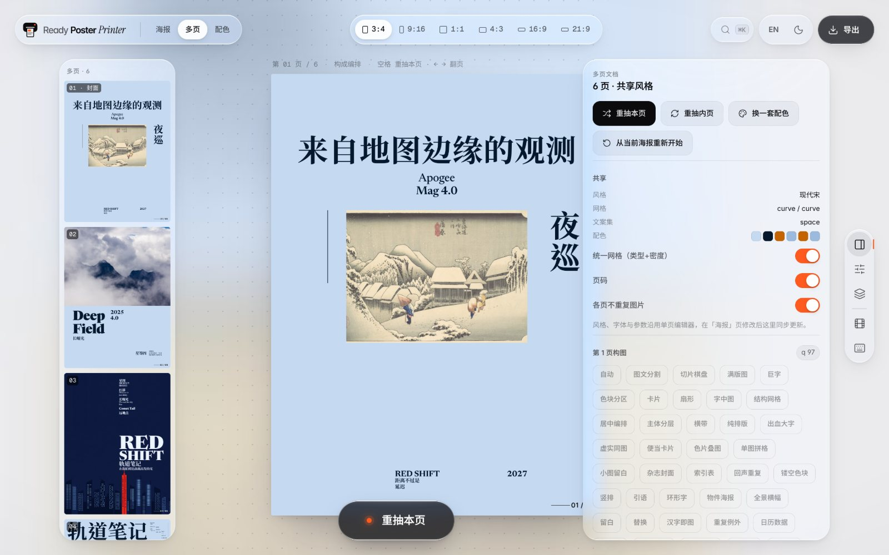 |
| 从 1340 套配色里抽，带 WCAG / APCA 对比度矩阵，一键用到海报上。 | 多页共用风格、网格和配色，每页单独抽，适合小册子和系列海报。 |

另外还有 200 条历史记录和收藏、⌘K 命令面板、深色模式、中英文界面，以及可选的本地 AI 抠图（可以让人物挡在标题前面）。

## 和 AI 生图有什么不同

| | AI 生图 | Ready Poster Printer |
|---|---|---|
| 文字 | 画出来的，可能写错，也没法改 | 真正的文字，点一下就能改 |
| 版面 | 每次都不一样，很难控制 | 按网格、字号层级和留白规则来排 |
| 看不看得清 | 看运气 | 每张都检查文字对比度，看不清会自动处理 |
| 换尺寸 | 重新生成 | 六种画幅一键切换 |
| 输出 | 位图 | PNG、JPG、可编辑的 SVG、PDF |

它本身不生成图片。照片和插画可以是你自己拍的、AI 生成的，也可以用内置的 142 张开放授权图片。用 AI 生图出画面、用它来排字，两者正好互补。

## 给 AI 助手和脚本用：命令行版

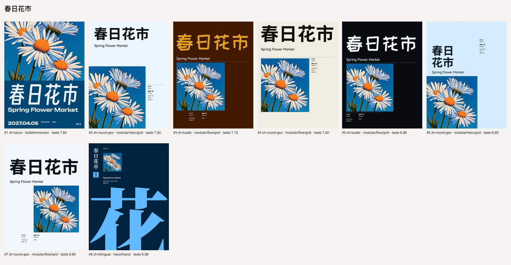

同一个排版引擎也能在命令行里跑，适合批量出图，也可以交给 Claude 这类 AI 助手调用。给它真实的文案和图片，它会生成一组候选、排好名次，每张都附一份检查报告：

- 标题、日期、地点这些信息有没有原样出现在海报上；
- 文字的对比度和字号够不够（按海报的显示场景来算）；
- 中文断行合不合规范，有没有缺字；
- 每张图片是不是都用上了，主体有没有被裁掉。

不合格的候选会被剔除并写明原因；合格的不够数时，才会用明确标出问题的候选补上（加 `--strict` 就只返回合格的）。

```bash
ready-poster-printer generate --title "教室里的春天" --subtitle "Picture Books for Spring" \
  --date 2027-03-14 --venue "城市少儿图书馆" --image picturebooks.jpg -n 8 -o out/
```

结果可以导出成 PNG、SVG、PDF，也可以存成网页版能打开的 JSON，再手动调整。让 AI 助手使用时，请加载技能说明 [ready-poster-printer](poster-printer-cli/skills/ready-poster-printer/SKILL.md)，里面写了怎么根据图片和文案选版式。

## 在自己电脑上运行

全部在本地运行，不需要注册账号。

### 最简单：下载后双击打开

不会用命令行也没关系，三步就能用：

1. **下载**运行包 [ready-poster-printer-dist.zip](https://github.com/ALBEDO-TABAI/ready-poster-printer/releases/latest/download/ready-poster-printer-dist.zip)（约 96 MB，也可以在 [Releases](https://github.com/ALBEDO-TABAI/ready-poster-printer/releases/latest) 页面找到）。
2. **解压**，得到一个 `ready-poster-printer` 文件夹。
3. **双击**里面的启动文件：
   - **macOS**：双击 `start.command`
   - **Windows**：双击 `start.bat`

稍等几秒，浏览器会自动打开海报编辑器（地址是 http://localhost:5180/ ）。用完关掉那个黑色的终端窗口就退出了。

电脑上需要有 **Python 3.9 或更新版本**，不需要装 Node.js。

- **Mac**：大多数 Mac 已经自带。如果双击后提示要安装「命令行开发者工具」，点「安装」，装好后再双击一次。
- **Windows**：到 [python.org](https://www.python.org/downloads/) 下载安装，安装第一页记得勾选 **Add python.exe to PATH**。

第一次打开时系统可能会拦一下，这是因为文件是从网上下载的，不是出了问题：

- **Mac** 提示「无法打开」：打开「系统设置 → 隐私与安全性」，往下找到这条提示，点「仍要打开」；或者右键点 `start.command` → 打开 → 打开。
- **Windows** 弹出「Windows 已保护你的电脑」：点「更多信息」→「仍要运行」。

你做的海报、收藏和上传的图片都只保存在你自己的浏览器里。

### 网页版（开发者）

需要 Node.js 22.12 或更新版本。字体、预设图片和配色数据都已经在仓库里了。

```bash
git clone https://github.com/ALBEDO-TABAI/ready-poster-printer.git
cd ready-poster-printer/poster-printer
npm ci
npm run dev
```

打开终端里显示的本地地址就能用了。完整说明见[网页版说明](poster-printer/README.md)。

执行 `npm run dist` 可以自己打一个上面那样的运行包，输出在 `poster-printer/release/ready-poster-printer-dist.zip`。

### 命令行版

先完成网页版的 `npm ci`，再从仓库根目录执行：

```bash
cd poster-printer-cli/engine
npm ci
npm run build
cd ../agent-harness
python3 -m venv .venv
.venv/bin/python -m pip install -e .
.venv/bin/ready-poster-printer --help
```

需要 Python 3.10+，以及 Chrome、Chromium、Edge、Brave 中的任意一个（会自动查找，也可以用 `POSTER_PRINTER_CHROME` 指定）。Windows 上用 `.venv\Scripts\ready-poster-printer.exe`。旧命令名 `poster-printer` 仍然可用。详见[命令行说明](poster-printer-cli/agent-harness/cli_anything/poster_printer/README.md)。

## 常用快捷键

| 按键 | 作用 |
|---|---|
| 空格 | 抽一张 |
| ← / → | 翻看历史 |
| 1–6 | 切换画幅 |
| T / P / R | 只换排字 / 图位 / 网格 |
| ⇧1–4 | 锁定文字 / 配色 / 主图 / 全部图片 |
| S | 快速导出 PNG |
| ⌘K | 命令面板 |
| ? | 查看全部快捷键 |

## 许可证

本项目原创程序代码采用 **GNU AGPL v3.0 only（AGPL-3.0-only）**，完整条款见 [LICENSE](LICENSE)。
字体、图片、配色数据及第三方代码保留各自的许可证和署名，详见[第三方授权说明](poster-printer/licenses/)。
