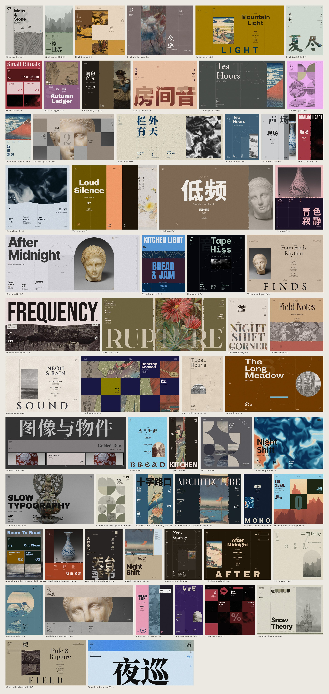
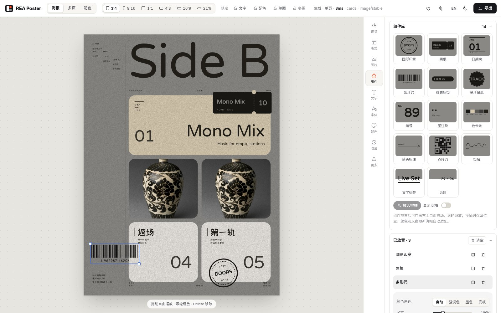
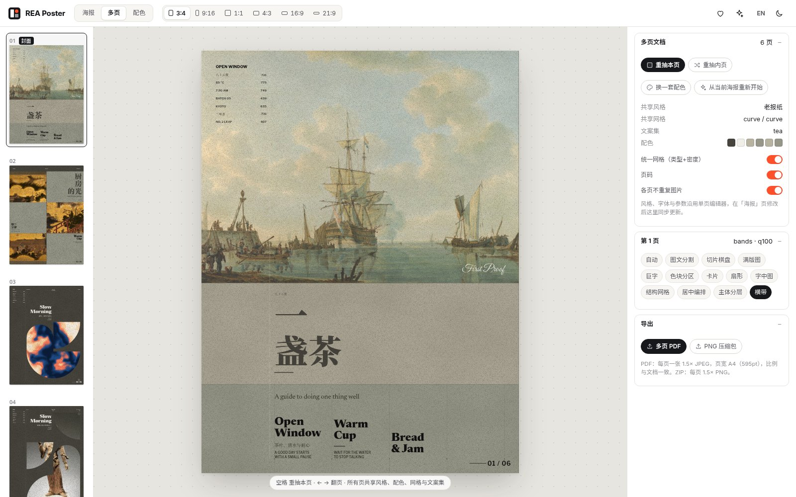
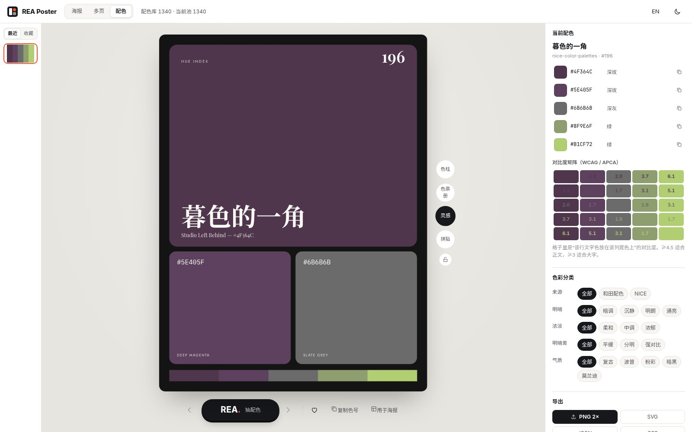

# Ready Poster Printer

(Renamed from *Poster Printer* in phase 16. Saved data, storage keys and older JSON exports keep working.)

**网格为骨 · 偶然为风** — a rule-based generative poster "draw" (抽卡) tool for the desktop browser.
Press one big button and get a new, deterministic, designer-grade layout: Swiss grids, title groups, CJK-aware type,
image slicing and masks, palette roles with guaranteed contrast. Then tune about 80 parameters, drag things around on the canvas,
and export an editable-text SVG or PNG at 1×/2×/4×. Phase 2 adds **component slots** (free placement), an **18-template sidebar
library** with per-template type size, **multi-page decks** (shared style + grid, per-page draw, multi-page PDF / PNG zip),
a standalone **palette-draw page** (`/color.html`), and a **layout-quality pass** that scores every draw and redraws bad ones.

Pages: poster `/` · deck `/?view=deck` · palettes `/color.html` · taste rating `/rate.html` (hidden) · dev lab `/lab.html`.

**UI (phase 7): floating glass.** The poster is the only object on an ambient, poster-tinted stage; all chrome floats over it
as refractive glass (top caps, rails, dock, panels, sheets). Simple by default, deep on demand: one draw button, an
inspector for this poster or the selected element, and an **Advanced** layer with every engine parameter organised by intent.

The app name lives in one constant, `src/config.ts → APP_NAME` (with `APP_SLUG` and `APP_SHORT`).



| | | |
|---|---|---|
|  |  |  |
| component slots + free-slot overlay | multi-page deck | palette-draw page |

---

## Run

### On your own Mac / PC (no Node needed)
Unzip **`release/ready-poster-printer-dist.zip`** and double-click `start.command` (macOS) or `start.bat` (Windows), or run `./start.sh`.
It needs only Python 3.9+ and opens `http://localhost:5180/`. Optional AI cut-out: `setup-ai.sh` / `setup-ai.bat`.
Full instructions (zh/en) are in the zip's `README.md` (source: `dist-kit/README-DIST.md`). Rebuild the zip with `npm run dist`.

### Development
```bash
npm ci                # Node.js 22.12+; bundled fonts are ready to use
npm run dev            # http://0.0.0.0:5180  (Vite dev server, binds all interfaces; checks fonts first)
# or production
npm run build && npm run preview -- --port 5180
python3 server/serve.py --root dist          # what the distributable runs: static app + /api/cutout in one process
```

### Optional: AI cut-out server (local, open-source models)
```bash
python3 -m venv server/.venv && server/.venv/bin/pip install -r server/requirements.txt
npm run cutout          # 127.0.0.1:8787, proxied by Vite at /api/cutout
CUT_MODEL=birefnet-general-lite npm run cutout   # optional BiRefNet (needs ~4 GB RAM; IS-Net is the light default)
```
Without the server, everything still works. The cut-out button reports that the service is offline, and the bundled pre-computed cut-outs are still used.

### Optional: AI copy
Open the left rail's **⚙ 会话、录制与设置** tab → **AI 设置** and enter any OpenAI-compatible endpoint, model and key (stored only in `localStorage`).
Without it, a local template writer produces bilingual copy offline.

### Tests & QA
```bash
npm test               # vitest — 250 unit tests: colour engine (Lab/OKLCH/k-means/WCAG/APCA/palette roles, taste bounds), layout engine (rng, kinsoku, optimal breaking, grids, every composition × ratio × mode, locks, perf), quality pass (≥95% of 240 draws free of overlaps/glyph hits), components, sidebar templates, PDF/ZIP writers
npm run qa:e2e         # Playwright/Chrome against the running app (1440×900), driving the glass UI: ratio control + keys 1–7 × draws (dock button / Space, exactly one draw per press), 10 modes + all-on, history (dock arrows, ←/→, film strip), variants, locks (top-cap buttons, ⇧1–4), determinism, selection → floating toolbar → in-place edit (⌘↵ / Esc) → inspector text + size edits → undo, drag-edit, Advanced (all 100 params reachable, scrub regenerates, search, layers), ⌘K (ratio + parameter commands), PNG 1/2/4× + SVG hooks and export-sheet downloads, every library tab, components, sidebar size memory, usage badges, G grid, theme + language toggles, deck view, palette page, rating page (rate/skip/undo/export + exact reproduction), reduced transparency/motion; fails on any console error
node scripts/qa/ui-port-shot.mjs [outDir] [states,comma,separated]   # 16 UI states + palette and rating pages × light/dark at 1440×900 (test-results/ui)
npm run qa:deck        # deck end-to-end: add/redraw pages, export a multi-page PDF and a PNG zip (validate with pdfinfo / unzip -t)
npm run qa:showcase -- showcase/posters scripts/qa/showcase-spec.json   # re-renders the showcase through the in-app exporter
python3 scripts/contact_sheet.py showcase/contact_sheet.jpg --labels showcase/posters/*.png
```
Showcase PNGs (`showcase/posters/`, ~130 MB) are regenerated, not committed; only the contact sheet and the UI JPGs in `showcase/ui/` are tracked.
The repository README's images (`.github/assets/`) are made in the real app with uploaded pictures.
Developer lab: `/lab.html?n=12&ratio=3:4,16:9&all=1&seed=X&style=…&comp=…&modes=…` renders a grid of posters for visual review.

---

## Architecture

```
src/
  config.ts                 app name / slogan / endpoints
  engine/                   pure, framework-free, deterministic (unit-tested in node)
    rng.ts                  string-seeded PRNG (sfc32 + xmur3); independent streams per layout/text/colour/image/decor
    params.ts               87 parameter definitions (sections, cards, ranges, units, zh/en labels)
    typo.ts                 font roles (large/small group × main/sub/note × Latin/CJK), recipes, "shake" pairing
    color/oklch.ts          OKLab/OKLCH, sRGB gamut mapping, per-hue "taste bounds" (chroma caps + lightness envelope)
    color/convert|contrast|extract|palette.ts
                            sRGB↔Lab/LCh, WCAG 2 + APCA, k-means++ in Lab (5 colours),
                            role assignment (bg / ink / accent / alt / light / dark / fills), modes normal/random/experimental,
                            soft, Wada/nice library modes, AA ink guarantee
    text/breaker.ts         CJK-aware line breaking with kinsoku (禁则), balanced / optimal-word / greedy modes
    text/measure.ts         font-metric width estimation (deterministic, no DOM)
    gen/grid.ts             orthogonal / skew / math-curve / image-friendly grids; densities simple…aggressive, curve, curve2
    gen/masks.ts            torn edges, brush strokes, arches, fans, rounded cards, glyph masks
    gen/ctx.ts              layout context: occupancy, fitted text groups, image placement + readability treatment
    gen/comps.ts            12 compositions (split, checker, fullbleed, giant, partition, cards, fan, typefill, swiss,
                            centered, layered, bands) + mode post-pass (brush image, brush mask, band mask)
    gen/decor.ts            grid decoration, nodes, numbers, ticks, curves, shapes, big glyphs, textures
    gen/sidebar.ts          18 sidebar templates in 10 families, per-template saved type size
    swiss/                  phase 16: the Swiss modular grid (lattice, template slicing solver, bleed-grid slicing trees,
                            typologies, the modular / bleedgrid compositions, companions for random draws)
    gen/quality.ts          layout-quality pass: collision avoidance (text vs text / giant glyphs / ornaments), occlusion
                            rule, effective-background contrast repair (recolour → label plate → outline), 0–100 score
    components.ts           14 placeable components (stamp, ticket, date, barcode, tag, star, index, caption, chips, arrow,
                            dot code, signature, label, folio) + free-slot finder
    gen/pick.ts             text, palette and image picking
    generate.ts             GenInput → { scene, picked, ms }; best-of-N attempts until score ≥ qualityMin or 120 ms budget
                            (avg ≈ 3–10 ms, hard test < 200 ms); placed components appended after the quality pass
    render/svg.ts           scene graph → SVG string (unique per-render ids, <text> kept as text)
  data/                     62 original styles (zh + en libraries), 8 bilingual text sets
  lib/                      fonts (lazy WOFF2 + shake), assets, user images (IndexedDB, palette/luma analysis),
                            exporter (SVG with embedded fonts → canvas → PNG/JPG), session JSON + WebM recording,
                            AI copy (OpenAI-compatible + offline fallback), edits (per-node overrides)
  deck/                     multi-page decks (shared style/palette/grid/copy set, per-page seeds) + DeckView
  color/                    standalone palette-draw page: 4 card layouts, filters, contrast matrix, copy, export, hand-off
  lib/pdf.ts, lib/zip.ts    minimal multi-page PDF (DCT images) and store-only ZIP writers (no dependencies)
  store.ts                  zustand: seeds, history (200), favourites, locks, variants, style CRUD, edits, record/replay
  styles/                   tokens.css (light/dark design tokens, UI fonts), glass.css (liquid-glass materials + fallbacks),
                            shell.css (chrome), grid.css (12-col layout grid, panel zones, G overlay), legacy.css (library panels), port.css
  ui/glass/glass.js         glass engine: SVG displacement refraction, bevel/blur/chromatic aberration, ambient field,
                            adaptive tint, liquid segmented thumbs (refraction approach after liquid-glass, MIT — see licenses/ui)
  ui/shell/                 Shell (layout, keyboard, URL states, ambient field), Chrome (top caps, rails, dock, caption),
                            Inspector (+ floating element toolbar), Advanced (intents → groups → tiers, layers & modes),
                            Library (styles, layout, images, text, palettes, fonts, parts, saved, settings), Film (history strip),
                            Sheets (export sheet, ⌘K palette, shortcuts), ia.ts (parameter → intent/group/tier map), actions.ts
  ui/                       Stage (direct manipulation on the poster), panels/ (library bodies), Lucide icons (ISC), zh/en i18n
  rate/                     hidden taste-rating page (/rate.html)
server/cutout_server.py     rembg + IS-Net / BiRefNet background removal over HTTP (local, dev)
server/serve.py             stdlib static server for the build + in-process /api/cutout when rembg is installed (dist)
dist-kit/                   start.sh / start.command / start.bat, setup-ai.*, README-DIST.md; scripts/make-dist.sh packs the zip
scripts/                    asset pipelines (palettes, fonts subsetting, Met CC0 fetch, procedural art, image processing),
                            credits builder, contact sheet, Playwright QA
```

**Generation flow:** `seeds + style params + locks → grid → composition → mode post-pass → decor → scene graph → SVG`.
Each seed controls its own stream, so "换文字 / 换图形 / 换色调 / 换图片 / 换倾向 / 换结构" re-roll just one dimension.
Since phase 17 the structure itself has three streams: grid (网格), picture placement (图位) and type (排字). Each can be re-rolled alone.
History entries store seeds plus the picked texts, palette and images, so restore is exact even after the libraries change.
Direct edits (move, re-type, image pan/zoom, hide) are stored as per-node overrides and applied after generation, so a parameter change keeps your edits.

---

## Design rules & quality loop (phase 3)

* The rules: one focal point, 3–4 type levels on a modular scale, a budget of 5–8 blocks, at most 3 decorations, 60/30/10 colour, at least 35–40 % quiet area, and subject-aware crops.
* `src/engine/gen/direction.ts` applies the rules after composition (see the "direction" card in More → `typeRatio`, `blockBudget`, `decorBudget`, `busyScrim`, `opticalTracking`, `snapGrid`). `src/engine/gen/audit.ts` scores them, and the result feeds the quality retry loop.
* Typography: optical tracking by size, CJK punctuation compression (`cjkLine`), hanging punctuation, widow control, and curated CN+EN pairings by mood (`src/data/pairings.ts`).
* Colour: OKLCH harmony score, de-mudded image palettes, accent boost, and an accent-share cap. Grain is a soft-light print tooth.
* Manual drags snap to grid edges, margins and centre lines with visible guides (hold Alt to move freely).
* Benchmark: `scripts/qa/quality-spec.json` (108 posters) → `showcase.mjs` (with `REA_DUMP=1`) → `scripts/qa/rescore.mjs`.

## Feature checklist vs SPEC (§3 / §12)

| Area | Status | Notes |
|---|---|---|
| One-button draw, status bar with ms, seeds | ✅ done | big PP draw button / Space; status shows ms, composition, grid |
| History ←/→, favourites | ✅ done | 200-entry history with thumbnails; favourites persisted |
| Ratios 3:4 9:16 1:1 4:3 16:9 21:9 1:2.1 | ✅ done | |
| Locks: text / colour / single image / multi image | ✅ done | |
| Style presets (zh + en libraries), update / save-as / delete, JSON import/export | ✅ done | 62 original styles |
| ~80 sliders, live preview | ✅ done | 83 params in 7 sections, collapsible cards, units |
| Grids: orthogonal / non-orthogonal / math curve / image-friendly, 6 densities, strength, opacity, zone strength | ✅ done | |
| Visible grid as decoration (lines, nodes, zone numbers, labels, guides) | ✅ done | |
| Image slicing across cells, masks (rect, rounded, circle, arch, fan, torn, brush, glyph fill, band) | ✅ done | |
| Modes: experimental, card, clash, random, layered, nice, wada, brush image, brush mask, band mask | ✅ done | |
| Auto readability treatment on images | ✅ done | darken / tint / scrim / grayscale + contrast-checked ink |
| Colour: k-means Lab 5 colours, roles, WCAG + APCA readout, normal/random/experimental, soft, lock, base colours, Wada / nice library with lightness/chroma/contrast/mood filters | ✅ done | 1340 palettes |
| Typography: role editor (family, weight, size, tracking, leading, case, italic), shake 1–3 fonts, English bias, copy large → small, CJK kinsoku | ✅ done | 182 open-licence families |
| Title groups (large/small), prose, meta/tick text | ✅ done | |
| Sidebar templates | ✅ done | 18 templates / 10 families (strips, data, paired, index, center, corners, timeline, colophon, ruler, tags); template grid in 版式; type size saved per template (localStorage); remove current sidebar |
| Variants 换文字/换图形/换色调/换图片/换倾向/换结构 | ✅ done | |
| Component library / slots (投放组件槽) | ✅ done | 组件 panel: 14 components with live previews, drop into best free slot or click a slot on the free-slot overlay, drag anywhere / wheel-scale / rotate / colour role / fixed copy, persists across draws, “save selected text as component”, My components + JSON import/export |
| Direct canvas editing: drag, double-click text editing, image pan/zoom, Esc, hide | ✅ done | |
| Canvas tune (contrast / saturation / brightness), textures (7 kinds) | ✅ done | |
| Export PNG 1×/2×/4×, JPG, SVG with editable `<text>` (optional embedded fonts), poster JSON | ✅ done | |
| Record & replay, session JSON, WebM capture | ✅ done | |
| AI cut-out (open-source, local) + subject-in-front-of-title layering | ✅ done | needs `npm run cutout`; 15 bundled cut-outs |
| AI copy with offline fallback | ✅ done | |
| Image library with categories, "mine", upload, credits | ✅ done | 76 presets (52 Met CC0 + 24 original procedural) |
| Chinese UI default + English toggle, light pro UI (+ dark) | ✅ done | |
| Font licence note | ✅ done | footer of the font panel (open-licence notice) |
| Standalone palette-draw page with 4 card layouts | ✅ done | `/color.html`: draw (Space), 4 layouts (色柱/色票册/灵感/拼贴) with lock, filters (source/lightness/chroma/contrast/mood), copy hex, WCAG/APCA matrix, recent + favourites, export PNG/SVG/JSON/CSS, “use in poster” |
| Multi-page deck / zine | ✅ done | `/?view=deck`: pages share style, fonts, palette, grid (type + density) and copy set; per-page draw, composition override, add/duplicate/reorder/delete, folios, no-repeat images; multi-page PDF + PNG zip |
| Image usage-count badges | ✅ done | count across history + favourites, top-left badge with tooltip |
| Layout-quality scorer / redraw | ✅ done | every draw scored (overlap, glyph hits, contrast, off-canvas, clutter, emptiness); redraws up to `qualityTries` within 120 ms; score shown in 更多 and the lab |
| Experimental colour within perceptual bounds | ✅ done | OKLCH construction + per-hue chroma caps (cyan ≤ 0.095) and lightness envelope; 300-palette test |
| Portable distributable | ✅ done | `release/ready-poster-printer-dist.zip` (~95 MB): build + Python server + start scripts + optional AI setup |

---

## Glass UI (phase 7)

**Layout.** Top caps (brand + 海报/多页/配色 · ratio + locks + undo/redo · ⌘K · 中/EN + theme · 导出), left rail (libraries),
right rail (inspector, advanced, layers, history, shortcuts), bottom dock (← n/N → · 文字/配色/图片 · **抽一张** · 结构 ▾/图形/倾向 · ♥ · history). The ▾ on 结构 opens the layer menu (网格 / 图位 / 排字 / 整体结构).
Panels open in fixed 12-column zones; the poster re-fits into the free zone and tucks slightly under the glass by design.

**Shortcuts.** Space draw · ←/→ history · 1–7 ratio · ⇧1–4 locks (text / colour / image / images) · ⌘K command palette ·
I inspector · A advanced · L layers & modes · H history strip · E export sheet · S quick PNG · F favourite · ⌘Z / ⇧⌘Z undo/redo ·
G show the poster's grid · g UI layout grid · ⇧D theme · ⇧L language · ? shortcuts · Esc closes the topmost layer.
On the poster: click selects (floating toolbar: edit / font / colour & size / AI copy / save as part / hide), double-click edits text in place
(⌘↵ commits, Esc cancels), drag moves with snapping (Alt = free), Delete hides the selection, images reframe in place.

**Fallbacks.** `prefers-reduced-transparency` (or `?rt=1`, or ⌘K → 减少透明度) swaps glass for solid frosted panels;
`prefers-reduced-motion` (or `?rm=1`) removes the liquid motion. Browsers without SVG backdrop refraction (non-Chromium) get blur-only glass.
URL states for QA/screenshots: `?open=adv,insp,lib:styles,film,cmdk,export,keys,grid,sel&intent=…&focus=…&q=…&grid=1&locks=…` (theme and language persist in localStorage).

**Taste rating page (`/rate.html`, not linked).** Shows live random posters one at a time: new seeds, weighted random ratio,
random built-in style, composition source 选择器 (default: the full product pipeline, taste selector on, K = 8) / 混合 / 全随机
(forced compositions, which bypass the selector). Rate with **1–9** (keys or the dock), **0 / S / Space** skip, **Z / ⌫ / ⌘Z** undo,
**I** shows the scores (hidden by default to avoid anchoring), **E** exports. Progress counter + target (50/100/200/500) and a histogram.
Ratings live in `localStorage` (`pp.ratings.v1`). The JSON export carries, per poster: rating, seed + all seeds, ratio, composition,
compMode, styleId, selector score (`taste`, the selector's score of the winner) and layout quality, selector settings, the full
history **entry** (seeds, params, modules, modes, fonts, picked texts/palette/images/plan/salt — what `entryScene()` needs to
re-create it), the regenerated **scene**, the 94 `sceneFeatures` recorded at rating time, and a `reproduced` integrity flag.
Retrain: `node scripts/taste/ratings-to-csv.mjs poster-printer-ratings-*.json --set U1` appends the ratings to `scripts/taste/train.csv`
(same 1–9 scale as the by-eye labels), then `cd scripts/taste && python3 train.py && python3 export.py`.

## Phase 13: adjust this poster vs pin for future draws

- Every control adjusts **this poster** live. The layout, copy, pictures and palette stay; controls tagged 会重新排版, 只换配色 or 只换文字 say what they re-pick.
- The **pin** on a control keeps its value for future draws. Pins show as chips under 抽一张, with 全部解除.
- The engine honours user choices over its plan, and reports when it has to repair legibility (仍用我的 overrides that).
- 16 essentials are shown, 27 under 更多, plus a 仅经典构图 group. Params, pins and history survive a reload.
- To check every control: `node scripts/qa/controls.mjs`.

## Repository size

Generated artefacts are no longer tracked: `public/fonts/` (31 MB, rebuilt by `npm run fonts` from `/workspace/fonts`) and the
showcase PNGs (~130 MB). **Git history still contains the earlier blobs** (`.git` ≈ 178 MB); shrinking it requires a history
rewrite (e.g. `git filter-repo --path public/fonts --path showcase/posters --invert-paths`), which has deliberately not been done.

## Licences

* **Code:** the original code in this repository. No LotGO code, assets, names or copy are used.
* **Fonts:** 182 families under SIL OFL 1.1 (179), Apache 2.0 (2) and the Ubuntu Font Licence (1), subset to WOFF2. See `licenses/FONTS.md` and the upstream licence texts in `licenses/fonts/`.
* **Palettes:** nice-color-palettes (MIT) and dictionary-of-colour-combinations (MIT; Sanzo Wada's 1933 book is public domain). See `licenses/PALETTES.md`.
* **Images:** 52 public-domain artworks from The Metropolitan Museum of Art Open Access (CC0 1.0) and 24 original procedural artworks (CC0 1.0, `scripts/gen-procedural.py`). Per-image provenance is in `licenses/IMAGES.md` and in `public/images/manifest.json`, and shows as a tooltip in the app. There are no copyrighted characters and no photographs of living people.
* **UI fonts:** Inter, Inter Tight, Geist, Geist Mono, Instrument Serif and a Noto Sans SC UI subset (all SIL OFL 1.1), self-hosted in `public/ui-fonts/` under namespaced family names; licence texts in `licenses/ui/`. No Apple fonts, symbols or logos are used.
* **Icons:** Lucide (ISC), inlined in `src/ui/lucide.ts`; `licenses/ui/LICENSE-lucide.txt`.
* **Glass:** the displacement-map refraction approach follows liquid-glass (MIT, attribution kept in `src/ui/glass/glass.js` and `licenses/ui/LICENSE-liquid-glass.txt`).
* **Models:** rembg (MIT), IS-Net (Apache-2.0, default) and BiRefNet (MIT, optional). See `licenses/MODELS.md`. Weights are not redistributed.

## Phase 4: art direction v2

The random draw now commits to a single idea for each poster.

**What the random draw does**
- About 28% of posters are type only.
- About 30% use single-hue palettes and about 6% use clash palettes.
- Most posters are flat; grain appears on 15% or fewer.

**New compositions**
- 纯排版 typo
- 出血大字 edge
- 虚实同图 ghost
- 便当卡片 bento
- 色片叠图 veil
- 单图拼格 mosaic
- 小图留白 inset

**Settings**
- There is a new 抽卡方向 (plan) card with sliders for the shares; turn off planV2 to get the phase-3 behaviour.
- Texture defaults to 自动 (auto).

**Images**
- 52 photos from Wikimedia Commons, all CC0.
- 8 original illustrations.
- Sources are listed in `licenses/IMAGES.md`.

## Phase 5: generator quality (Poster Printer)

The app is now called **Poster Printer** (slug `poster-printer`). The name lives in `src/config.ts` (`APP_NAME`, `APP_SLUG`, `APP_SHORT`). Internal storage keys (`rea.*`) and the `REA_*` dev env vars are unchanged so saved data and tooling keep working.

**Seven new compositions** in `src/engine/gen/comps3.ts`:
- 杂志封面 cover: a curated masthead with the subject in front when an offline cut-out exists, cover lines and a barcode.
- 索引表 index: programme, list and spec-sheet tables.
- 回声重复 echo: a repeated word in outline or tonal rows with one solid row.
- 镂空色块 knockout: a headline punched out in the field colour on an accent block, plus a photo.
- 竖排 vertical: CJK vertical columns or a rotated Latin spine.
- 引语 quote: a quote-led page with a photo plate.
- 环形字 ring: type set on a circle around a photo or numeral disc.

**Other generator changes**
- Original procedural stickers (round sticker, tag, tape, barcode) appear sparingly, on about 14% of collage-friendly layouts.
- Thin CJK faces are swapped for Source Han 900 when a composition needs weight.
- The centred layout's repeated spaced footer word is fixed.

**Sampler**
- It is entropy-aware: weights are flattened, and the compositions used in the last 4 draws are down-weighted.
- Layouts that rated below 7 no longer appear in auto draws. They can still be picked by hand.
- Long formats use only knockout, cover and edge (edge up to 2:1), and keep their picture.

**Images**
- 28 offline cut-outs precomputed by `scripts/precompute-cutouts.py` and checked by eye (see `licenses/IMAGES.md`).

## Phase 6: taste selector (generator only)

- **Taste selector.** Each fresh auto draw builds 8 candidates (`SELECT_K` in `src/store.ts`) and keeps the best by a learned aesthetic score (`src/engine/aesthetic/`: scene features, gradient-boosted tree model, scorer). One challenger composition is tried when the best is weak. Mean ~30 ms per draw in the browser (main thread). Replays are exact (winner's salt, composition, plan and seeds are stored).
- **Model training.** `scripts/taste/`: `TASTE_EXPORT=1 npx vitest run scripts/taste/export-features.test.ts` writes `train.csv` from rated renders; `python3 scripts/taste/train.py` reports leave-one-set-out and held-out agreement; `python3 scripts/taste/export.py P6` regenerates the shipped `model.ts`.
- **Sampler v2.** `src/engine/gen/sampler.ts`: archetype-first, entropy-aware weights; phase-5 rejects are back on probation.
- **New compositions.** 物件海报 object and 全景横幅 panorama (`src/engine/gen/comps4.ts`).
- **Fixes.** Wide-format composition set, short CJK headlines on pale grounds, heavy faces in knockout, depth covers with the subject overlapping the masthead.

## Phase 7: idea layer, gates, CJK pass (generator only)

- **Idea layer.** `src/engine/gen/ideas.ts` has 14 original rule systems: scale shock, substitution, occlusion, repetition with one anomaly, reveal, tension edge, emptiness, data-as-form, hanzi-as-image, split meaning, orbit, voice, specimen and immersion. Each draw picks one idea first. Its composition, Itten contrast, frame and single rule-break follow from that idea. You can force one with the `idea` param. There are six new compositions in `comps5.ts`: ma, substitute, hanzi, anomaly, calendar and window.
- **Gates.** `src/engine/aesthetic/gates.ts` checks each draw on a 40-cell raster: flat fills, hue families, the 64 px thumbnail, accent, tone band, headline ΔL, style-read centroid and near-misses. A hard failure redraws within a counted retry budget. Soft failures are penalties in the selector rank.
- **CJK.** Chinese text gets measured optical tracking, Han↔Latin quarter spaces and no one-character last lines (`src/engine/text/breaker.ts`, `typo.ts`, `gen/ctx.ts`).
- **Selector.** The model is retrained with idea, Itten, gate and Ngo features. `scripts/taste/ratings-to-csv.mjs` fills in new feature columns for older `rate.html` exports.

## Phase 8
Design strategy (coupled grammars: typeled / interleave / programme / exhibit) is now a unit of randomness on top of the P7 selector, with scene semantics, semantic line breaking, exemplar-retrieved routes, problem-tied mutations and a MAP-Elites archive. Real copy is never padded with filler.

## Phase 16: the Swiss modular grid, several pictures, full bleed

Two new compositions lay out **several pictures of different sizes** on a real modular grid.

**The grid.** Fields are separated by gutters, and one field plus one gutter is a whole number of baseline lines. Every picture and text region spans whole fields.

**模块网格 `modular`.** Typologies (control 网格版式 / `gridLayout`):
- hero + satellites (主图卫星)
- flowline (悬挂线)
- scale steps (尺度递进)
- strip (图片横条)
- module blocks (模块分区)

A dynamic-programming slicing solver fits each picture's span to its own proportion and keeps the subject in frame. The hero is the largest and may bleed off its outer edges. White fields are planned, and empty bands across the middle are rejected.

**满版拼图 `bleedgrid`.** Pictures fill the sheet edge to edge in a slicing tree solved for the sheet's proportion, so every picture keeps its own proportion. The type gets a cell of its own: paper, accent or ink, with seams none, hairline or gap. Typologies: mosaic (满版拼贴) and justified rows (满版行列).

**Random draws** add 2–6 companions from the same source tier and category. With several pictures of your own (uploaded, picked or locked), the grid compositions lead.

**CLI.**
- Briefs take picture sets: `style.imagery.files` / `ids` / `layout` / `count`.
- The resolver analyses the set and recommends layouts with reasons.
- A new `images` correctness gate checks that every given picture is drawn and readable.
- User images get a subject box.
- New and extended commands: `images add` (stable ids), `images inspect`, `catalog layouts`, `generate --image … --layout …`.

**Agent skill.** `poster-printer-cli/skills/ready-poster-printer/` (`SKILL.md` + `LAYOUT_METHOD.md`) is the method for choosing a layout from the user's pictures and copy.

## Phase 17: the structure in three layers (网格 / 图位 / 排字)

**结构** is now a split button. Its label re-lays out the whole structure, as before. The ▾ opens the layer menu:
- **网格 Grid** (`R`): a new grid system (columns, margins, baseline, modules). Pictures and type re-flow into it.
- **图位 Placement** (`P`): the pictures move. The type is set again around them.
- **排字 Type** (`T`): only the typesetting changes: line breaks, alignment, headline size, colour, where the info block sits. **Every picture stays exactly where it is.**

The menu stays open, so you can press 排字 a few times in a row. Each press is one undo step.

In layouts where the picture position is part of the design (full bleed, a set plate, a disc), 图位 is disabled with the reason.

Under the hood:
- The layout seed feeds three independent streams. A re-roll salts one of them, and the salts are stored with the poster.
- Posters made before this version replay exactly as before (checked against the phase-16 build).
- CLI: `variations --vary type|place|grid`.

## Phase 18: the construction engine (构成编排)

A new composition, **构成编排 `build`**, now makes most automatic draws (70%; 50% with several pictures). It is built from a study of designers' text-group construction methods.

- **Text groups are constructions.** A library of 34 constructions: justified bricks, cap-locked side stacks, rule sandwiches, ticket frames, staircases, number locks, corner satellites… Sizes step in fixed ratios, gaps are line heights, notches are closed, and one level carries the accent.
- **19 page archetypes.** Photo band, full bleed (type only on calm, high-contrast zones, never on the subject; no scrims), open side, masthead, centre frame, window, split, plate, picture strip, mosaic, giant block, type fill, Latin architecture, gate, scattered grid, quiet emblem, totem, info form, colour mass.
- **A real grid layer.** Margins, columns, rows and gutter. Photos stop on row lines, frames and measures span whole columns.
- **Every re-roll shows something new.**
  - **网格** moves the page onto another grid and keeps the archetype and type.
  - **图位** changes the archetype and keeps the type where it fits.
  - **排字** changes the construction and keeps every picture.
- **Pin it.** Advanced › 页面原型 / 文字组构成 (`archetype`, `construction`) pin an archetype or a construction.

## Phase 19: set every colour yourself (palette editor)

The 配色 library tab used to show the poster's colours read-only. Now every colour opens an editor in place.

- **Every colour.** The five roles (底色 / 主文字 / 次文字 / 强调 / 辅色), each block fill (色块) and each source colour (色源) are buttons. The editor has a saturation / brightness field, a hue strip, a hex field, the screen eyedropper (pick from the poster or a photo), quick picks (source, photo, this poster, recent) and the contrast that matters for that colour.
- **Live, layout kept.** Dragging re-colours the poster every frame. The construction layouts never move; the older modular / bleed grids make a few colour-dependent choices (an accent cell only when it contrasts), so a very different palette can re-fit their type now and then. Each gesture is one undo step. A colour resets on its own, or all at once (还原全部); 明暗互换 swaps ground and ink.
- **Only what you set is yours.** The roles you did not touch follow from the drawn palette where they must: a new ground gets an ink that reads on it, a new ink a matching soft ink, block fills follow a new accent / alt. Text is never set in an ink that can't be read; the editor names the readable stand-in and makes it the ink in one click.
- **This poster, or every draw.** Colours belong to the poster (like a slider tweak). The pin in the editor keeps one for future draws; pinned colours show in the pins bar under 抽一张, and 全部解除 clears them too. 锁定配色 still keeps the whole palette.
- **Your own combination.** Edit, add (+) or remove source colours: the poster re-assigns its roles from them, and so do future draws. 保存配色 keeps the palette under 我的配色 for one-click reuse.
- **Fixed:** picking a library palette (and the palette page's hand-off) now re-colours the poster on screen, not just the next draw.
- **CLI:** `refine --color bg=#f3e9d2 --color accent=#e4002b` (roles `bg ink inkSoft accent alt`, block fills `f0…f5`, `=auto` releases one).

Under the hood (`src/engine/color/palette.ts` → `withRoles`): the edits ride on the palette (`palette.user = { base, edits }`), so a poster replays exactly in the app and the CLI. A palette without user colours is returned untouched, and posters made before this version replay byte-identically (checked against the previous build).

## Phase 20: panels and the poster move as one

- **One timing.** Opening, closing or switching a side panel is one motion on one time and curve (`--shift`, 420 ms): the panel slides, the poster glides to its new place, and the dock and pins bar follow.
- **The poster glides on the compositor.** It used to animate the canvas zone's edges and its own width and height, which needs the main thread every frame. It also jumped to the zone's far edge first, then slid back. Now it is laid out at its new place at once and animated there by transform from where it was seen (FLIP, `fitFrame(from)` in `Shell.tsx`), so a panel mounting its controls can't stall or jerk it.
- **Plain blur while moving.** During the motion the glass shows a plain blur instead of its SVG refraction (`body.shifting`), and glass maps for surfaces that change size mid-motion are built once, at the end.
- **Background work waits.** Thumbnails wait until the motion is done (`holdIdle`).
- **Switching fixed.** 高级调校 and 图层与模式 are two views of one panel: from Layers, the 高级调校 button switches back to the last Advanced view instead of closing the panel, and opening Advanced never lands on Layers. View switches fade in.


## Phase 21: style previews are what you get

The style library (风格) used to show the current poster with only the style's settings swapped in. It kept that poster's layout and colours, cropped the poster to 3:4 and didn't load the style's fonts, so every card looked alike. Clicking a card then drew a brand-new random poster.

- **A card is the click's result.** Each card is the poster a click makes: your copy and pictures with that style's fonts, settings, layout and colours. The click replays that very result (`stylePreview` / `pickStyle` in `store.ts`).
- **Each card draws its own poster.** Each style draws its own layout and colours from the poster's seeds (`styleSeeds`). The card of the style the poster was made in is that poster.
- **Cards stay put.** Picking a style keeps the content it was applied to (`styleBasis`, stored with the entry), so the other cards don't change. They follow a new draw or edited copy, dimmed while they re-render.
- **Fonts first, whole poster.** Cards load their style's fonts before rendering, only when they come into view, and show the whole poster at its format.

**Fix (construction engine):** with real copy, an info line that is exactly the date (e.g. `2027.05.20`) is the date. It was set twice ("2027.05.20 — 2027.05.20", or once in the text group and again in a side block). It is now set once, through the date slot (`copy.ts`, `usedTexts`). Random draws and earlier posters are unchanged (72 draws and replays checked byte-identical).

## Known limits

- **Real copy outside the construction engine.** With custom text, the older compositions show sample words in the slots the copy leaves empty, and some leave a given line out. 构成编排 `build` keeps the copy (no sample words in 60 draws, the subtitle dropped in 9). The automatic layout picks `build` most of the time, but 26 of 60 automatic draws still had a problem. The CLI is not affected.

## License

Original program code is licensed under [GNU AGPL v3.0 only](../LICENSE). Third-party code, fonts, images and palette data retain their respective licenses and credits in [licenses/](licenses/).
